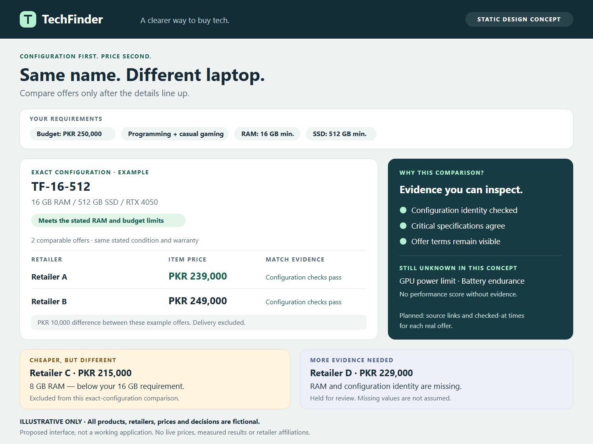

# TechFinder
### Buy the right configuration. Compare the right price.

**AI-assisted technology discovery and price comparison for Pakistan.**

TechFinder turns inconsistent retailer listings into a catalogue that buyers can actually compare. It helps answer two questions: **Is this really the same device?** and **Is it suitable for what I need?**

**Status:** Proposal and design stage · **Planned prototype:** October 24, 2026

**Category:** AI in Retail & E-Commerce

**GitHub:** [github.com/zainahmadlums/techfinder](https://github.com/zainahmadlums/techfinder)

> This repository contains the project proposal and supporting design material. The interface below is a static concept, not a working application. All products, retailers, prices and matching decisions in the concept are fictional. No evaluation results or retailer partnerships are claimed.

## The problem

A buyer sees two laptops with similar names and different prices. One has 16 GB RAM, the other 8 GB. The cheaper listing may also have an unspecified display, warranty or GPU power limit. A price comparison is only useful after those differences are understood.

TechFinder proposes to make that verification visible, then help buyers compare suitable products using their budget and priorities.

## What makes the approach useful

| Buyer question | Planned response |
|---|---|
| Are these offers for the same configuration? | Compare model identifiers and critical specifications; keep conflicting configurations separate. |
| Why is this device recommended? | Show how it meets the buyer's requirements and which trade-offs remain. |
| Is a technical claim supported? | Attach sources to specifications and distinguish measured, specified, estimated and unknown values. |
| Is this still the price? | Show when each offer was checked and link to the retailer for confirmation. |

The main technical contribution is **configuration-aware product matching**. AI proposes likely matches and extracts messy specifications; explicit checks decide whether listings can safely be grouped. A plausible name match is not enough.

## A focused, demonstrable first release

The proposal covers laptops, components, smartphones and desktops. For the finale, the acceptance-critical path will focus on **laptops**, where configuration differences make a particularly clear demonstration.

- Target **50–100 retailer listings**, which may represent fewer unique product configurations.
- Target **three accessible retailer sources**, subject to permitted access and usable data.
- Demonstrate ingestion, normalization, matching, offer comparison and an initial preference-based recommendation flow.
- Use a small, source-backed subset for detailed hardware comparisons.
- Treat other categories, price history, alerts and a PC builder as extensions after the core flow works.

If live access is unavailable, a dated, manually curated dataset can demonstrate matching and comparison. The presentation will explicitly disclose that limitation; it will not count as a successful live integration.

## The demo in one minute

1. Enter a budget and essential requirements, such as at least 16 GB RAM.
2. Open a suitable product and compare two offers for its exact configuration.
3. Inspect a cheaper, similarly named listing and see why its 8 GB configuration is excluded.
4. Change the priorities and inspect the recommendation explanation, including missing evidence.

See the [demo storyboard](docs/demo-storyboard.md) for the planned screens and presentation script.

## Supporting material

| File | What it shows |
|---|---|
| [Project proposal](proposal.md) | Problem, solution, target users, deliverables, resources, risks and timeline. |
| [Interface concept](assets/techfinder-concept.svg) | A visual illustration of comparable offers and a rejected configuration match. |
| [Demo storyboard](docs/demo-storyboard.md) | A concrete buyer journey and a short judging demonstration. |
| [Technical architecture](docs/technical-architecture.md) | Data flow, matching rules, evidence handling and a bounded implementation plan. |
| [Evaluation plan](docs/evaluation-plan.md) | Proposed acceptance tests and metrics, with results clearly left unmeasured. |

## Success will be measured

The prototype should demonstrate more than a convincing interface. Planned evaluation covers extraction correctness, false product merges, recommendation constraints and offer freshness. The [evaluation plan](docs/evaluation-plan.md) defines the samples, calculations and proposed targets before development. **Targets are not achieved results.**

## Planned stack and schedule

Python collectors → normalization and AI-assisted matching → PostgreSQL → FastAPI → React / Next.js.

| Dates, 2026 | Checkpoint |
|---|---|
| Oct 12 | Scope, schema, example cases and interface design |
| Oct 13–15 | Data access and collection; normalized listing records |
| Oct 16–18 | Matching rules, review queue and a labelled evaluation set |
| Oct 19–21 | Catalogue, filters, offer comparison and evidence display |
| Oct 22–23 | Recommendations, evaluation and demonstration rehearsal |
| Oct 24 | Prototype demonstration and transparent results report |

The project links buyers to retailers; it does not process purchases. Proposed integrations with Paklap, Czone and RBTech are subject to access checks and do not imply affiliation.
