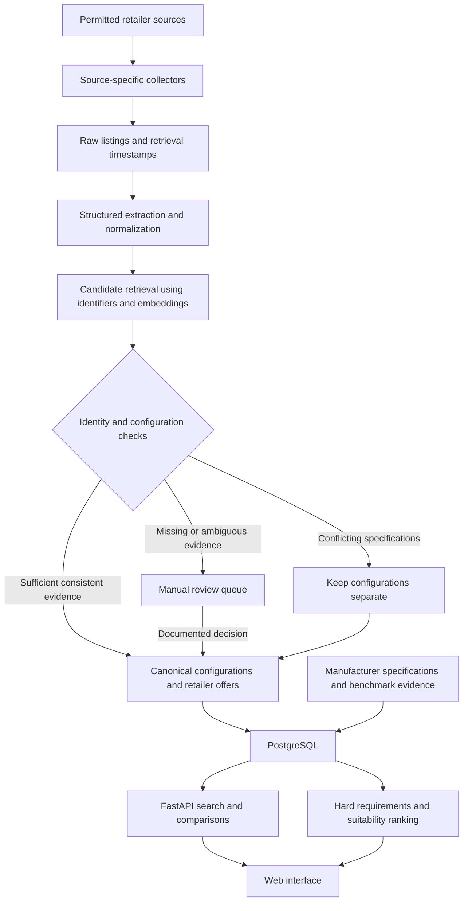

# TechFinder — proposed technical architecture

**Status:** Implementation design. The components below are planned and are not yet implemented in this repository.

[Repository](https://github.com/zainahmadlums/techfinder) · [Proposal](../proposal.md)

## System flow

## Minimum data model

| Record | Essential fields | Purpose |
|---|---|---|
| Retailer | ID, name, domain, access method | Trace where an offer originated. |
| Raw listing | Retailer ID, source URL, title, permitted source excerpt, retrieved time, extraction version | Reproduce extraction and inspect mistakes. |
| Configuration | Brand, family, exact model or SKU, CPU, GPU, RAM, storage, display, regional variant | Represent a specific configuration rather than an entire product family. |
| Offer | Configuration ID when resolved, retailer ID, price PKR, availability, condition, warranty, delivery information, observed time | Preserve commercial differences between sellers. |
| Evidence | Field name, value, source URL, retrieved time, evidence type | Distinguish manufacturer specifications, measurements, estimates and unknowns. |
| Match decision | Listing pair, proposed relationship, checks, decision, explanation, reviewer if applicable | Make grouping auditable and reversible. |

An unresolved listing may have no configuration link. Do not force every listing into an existing product. Price observations can be retained for auditability; price-history charts are outside the first release.

## Matching policy

1. Normalize units, brand/model spellings and common CPU/GPU aliases while preserving the original text.
2. Prefer structured identifiers and deterministic extraction. Use an LLM for irregular text when needed, with a constrained output schema and quoted source evidence.
3. Retrieve plausible candidates using identifiers and, if useful, embeddings. Similarity is a retrieval signal, not proof of identity.
4. Check exact identifiers and critical fields. CPU, GPU, RAM, storage and display conflicts prevent automatic merging; regional variants must be resolved when relevant.
5. Automatically group only when the evidence satisfies the documented rule. Missing identity or critical specifications go to review. A matching model number alone does not override a configuration conflict.
6. Record the decision and source evidence so a bad merge can be corrected without losing the original listings.

Different condition or warranty terms must stay visible at offer level. Used/refurbished and new offers are not presented as equivalent in the default comparison. Any seller upgrades need explicit evidence and belong to the resulting configuration.

## Where AI adds value

| Step | AI-assisted role | Deterministic boundary |
|---|---|---|
| Extraction | Parse inconsistent specification text. | Validate types, units and source support; absent values remain unknown. |
| Candidate search | Find likely duplicates despite title differences. | Require identity and configuration checks before grouping. |
| Explanations | Translate supported facts into accessible language. | Generate only from recorded evidence and ranking reasons. |

Use a simple identifier/rule baseline first. Compare it with the AI-assisted pipeline on the same held-out cases to establish whether AI improves coverage without creating more false merges. AI should earn its place through measured benefit.

## Recommendation policy

**First, eligibility:** apply budget and essential specification constraints. Exclude known failures; mark unresolved required fields as pending evidence.

**Then, suitability:** combine normalized, evidence-backed criteria using published weights that sum to one. Keep suitability and price/value views distinct. Component ratings out of five are a planned presentation layer and require documented scoring anchors before release.

Do not substitute a made-up number for unknown battery life, cooling quality or GPU power. For the initial ranking demonstration, prefer a smaller set with adequate comparable evidence. If a criterion cannot be supported, disclose that it is unavailable and avoid implying a complete score. Any reduced-criterion comparison must say which criteria were used and apply the same criteria to every compared candidate.

Show a short rationale that distinguishes hard requirements, weighted preferences and unresolved evidence. An explanation must not upgrade a manufacturer specification into a measured result.

## Freshness and collection failures

- Store times in UTC; display readable local times with a timezone.
- Proposed prototype policy: flag observations older than 24 hours as stale. This is a design threshold, not a guarantee that a price stays valid for 24 hours.
- Record refresh failures without replacing the last successful observation time.
- Retry transient failures conservatively; do not work around access restrictions.
- If a source is unavailable, label the old observation or use a disclosed curated snapshot.
- Send the buyer to the retailer to confirm stock, warranty, delivery and final price.

## Delivery order and scope controls

| Checkpoint | Evidence of completion | If delayed |
|---|---|---|
| One-source ingestion | Source URLs and timestamped, normalized records | Use permitted manual capture with provenance; disclose the change. |
| Multi-source matching | Correct matches, rejected conflicts and review cases | Reduce product count before relaxing matching rules. |
| Comparison interface | Configuration view with distinct offers and evidence | Prioritize this over secondary categories. |
| Recommendation flow | Hard filters and reproducible, supported ranking explanations | Restrict scoring to the evidence-rich subset. |
| Evaluation and rehearsal | Report with counts, failures and source coverage | Drop extensions rather than omit evaluation. |

## Practical requirements

Python, an API/backend runtime, PostgreSQL, a browser frontend and access to permitted source data. Hosted model APIs are optional during baseline development. Keep API credentials outside the repository. Cache repeated parsing and embedding work; record model usage and latency during the prototype to guide later hosting decisions.

No retailer agreements, benchmark licences, hosting budget or operational service-level commitments have been secured by this design document.
